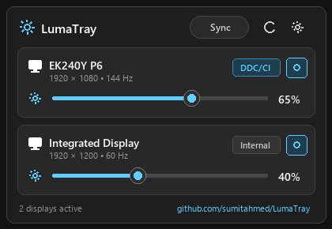
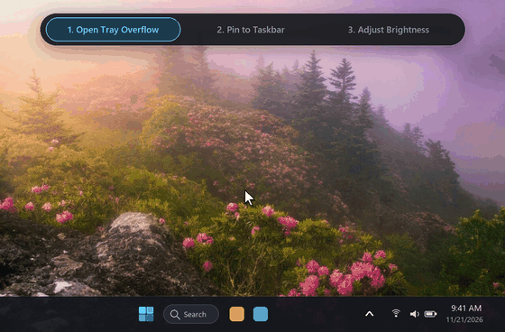
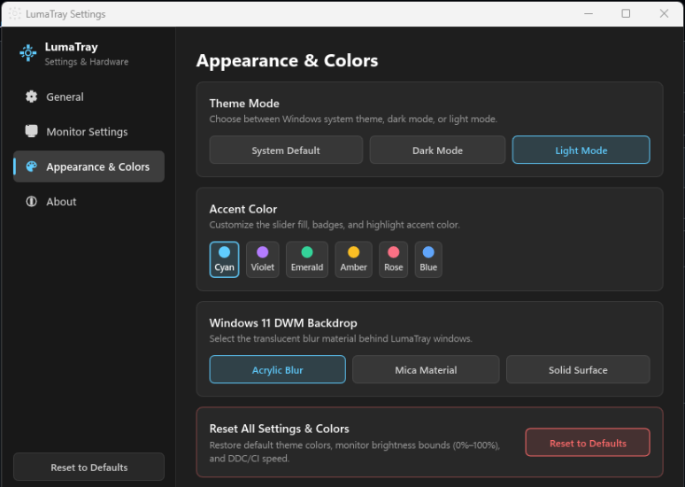
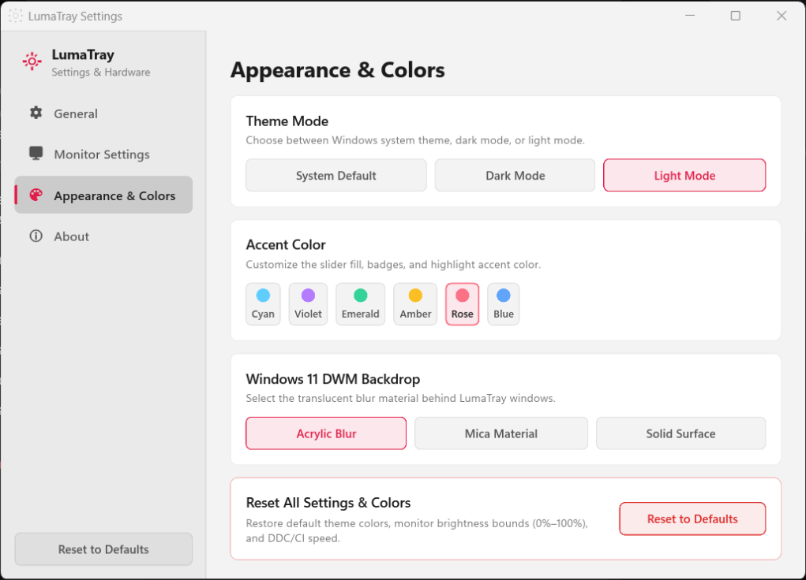
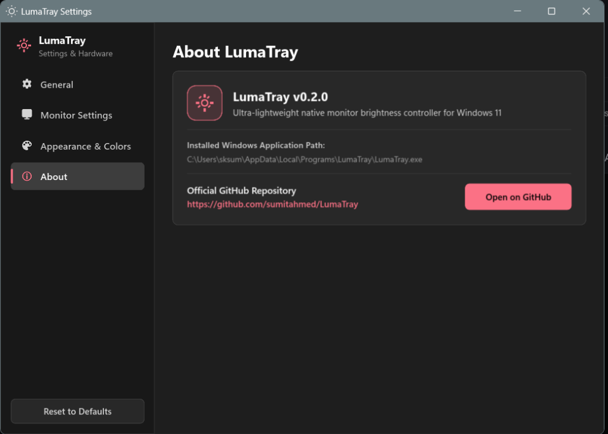
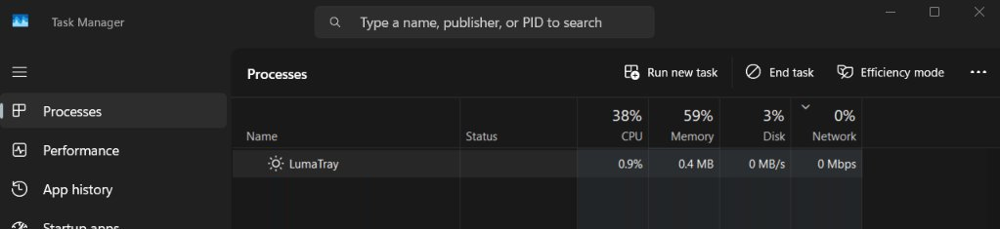

# LumaTray

[-0078D4?style=for-the-badge&logo=windows&logoColor=white)](https://github.com/sumitahmed/LumaTray/releases/latest/download/LumaTray.exe)
[](https://github.com/sumitahmed/LumaTray/releases)
[](https://github.com/sumitahmed/LumaTray/releases/latest)

LumaTray is a native Windows 11 monitor brightness controller written in Rust and Slint. It runs in the system tray and controls external displays over DDC/CI and internal laptop panels over WMI without an Electron or WebView2 runtime.

Repository: https://github.com/sumitahmed/LumaTray  
Latest Release (`LumaTray.exe`): https://github.com/sumitahmed/LumaTray/releases/tag/v0.2.0

## Preview

### Tray Brightness Flyout & First-Run Walkthrough

| Brightness Flyout | Tray-Pinning Walkthrough (`WelcomeWindow`) |
| :---: | :---: |
|  |  |

### Settings & Appearance

| Appearance & Accent Colors (Dark Mode) | Appearance & Accent Colors (Light Mode) | About & Installed Path |
| :---: | :---: | :---: |
|  |  |  |

### Memory Footprint (`0.4 MB` in Windows Task Manager)



## Features

- **Hardware Display Control**
  - External monitors via Windows DDC/CI (`dxva2.dll` / VCP `0x10`, `0x13`, `0x6B` fallback probing, and optional contrast `0x12`).
  - Internal laptop panels via Windows WMI (`ROOT\WMI`, `WmiMonitorBrightness` and `WmiMonitorBrightnessMethods`).
  - Automatic deduplication so internal laptop panels are not listed twice under both DDC/CI and WMI.
- **Display Sync & Calibration**
  - Master brightness slider to adjust all linked displays together.
  - Per-display link toggles and configurable hardware min/max brightness bounds (`0% - 100%`).
  - Write coalescing (`WriteCoalescer`) on a dedicated hardware worker thread to prevent I2C bus stalls during fast slider drags.
- **Windows 11 Integration**
  - Tray-anchored flyout using Win32 DWM Acrylic/Mica backdrops, rounded corners, and DPI-aware bottom-right positioning.
  - Self-installing per-user setup (`%LOCALAPPDATA%\Programs\LumaTray\LumaTray.exe`), Start Menu shortcut registration (`LumaTray.lnk`), and self-healing `Run` + `StartupApproved` autostart entries.
  - Automatic display hotplug and sleep/wake handling (`WM_DISPLAYCHANGE`, `UxdDisplayChangeMessage`, `WM_POWERBROADCAST`).
- **On-Demand Settings & Welcome Walkthrough**
  - Sidebar Settings window (General, Monitor Settings, Appearance & Colors, About) created lazily on demand and released on close.
  - Live resolution and refresh rate telemetry (`EnumDisplaySettingsW`).
  - Theme modes (`System`, `Dark`, `Light`), 6 accent presets, backdrop material selection, and a factory reset option.
  - Interactive first-run tray-pinning walkthrough (`WelcomeWindow`).
- **Low Memory Footprint**
  - Idle working set typically stays around `1 - 3 MB` after Win32 working-set trimming (`SetProcessWorkingSetSize`), rising briefly when the flyout or settings windows are open and dropping back when closed.

## Architecture Overview

LumaTray is split into four layers:

1. **HAL (`src/hal/`)**: Platform-agnostic `DisplayDriver` trait backed on Windows by `WindowsDisplayManager` (DDC/CI + WMI + `QueryDisplayConfig` / `EnumDisplaySettingsW`).
2. **Core (`src/core/`)**: Thread-safe `StateStore`, `HardwareWorker` actor with `WriteCoalescer`, `DisplaySyncEngine` piecewise linear mapping, and JSON persistence in `%APPDATA%\LumaTray\config.json`.
3. **Platform (`src/platform/win32/`)**: Win32 message-only tray daemon, taskbar work-area anchoring, `WM_ACTIVATE` click-outside auto-dismissal, DWM backdrop/icon helpers, startup registry management, and Start Menu/uninstall registration.
4. **UI & Bridge (`ui/`, `src/ui_bridge/`)**: Slint UI (`MainWindow`, `SettingsWindow`, `WelcomeWindow`) bridged to `StateStore` and `HardwareWorkerHandle` on the UI thread.

For full implementation details, module responsibilities, and threading diagrams, see [docs/ARCHITECTURE.md](docs/ARCHITECTURE.md).

## Tech Stack

- **Language**: Rust (Edition 2024)
- **UI**: Slint `1.18.1` (`slint`, `slint-build`)
- **Windows APIs**: `windows` `0.62.2` (Win32 GDI, Display/DDC, WMI/COM, Shell, DWM, Registry, HiDpi)
- **Concurrency & State**: `crossbeam-channel` `0.5.17`, `parking_lot` `0.13.0`
- **Serialization & Logging**: `serde` `1.0.229`, `serde_json` `1.0.154`, `thiserror` `2.0.21`, `tracing` `0.1.44`, `tracing-subscriber` `0.3.23`

## Installation & Usage

Download `LumaTray.exe` from the [v0.2.0 Release](https://github.com/sumitahmed/LumaTray/releases/tag/v0.2.0) (or build from source) and run it directly:

1. On launch, LumaTray copies itself to `%LOCALAPPDATA%\Programs\LumaTray\LumaTray.exe` (if run from another folder) and creates a Start Menu shortcut at `%APPDATA%\Microsoft\Windows\Start Menu\Programs\LumaTray.lnk`.
2. On first run, the "Hello, LumaTray!" walkthrough opens to show how to move the tray icon out of the Windows taskbar overflow menu.
3. Left-click the tray icon to open the brightness flyout; right-click for `Refresh Displays`, `Settings...`, and `Exit LumaTray`.
4. Logs and config are stored at:
   - Config: `%APPDATA%\LumaTray\config.json`
   - Log: `%APPDATA%\LumaTray\luma.log`

## Building from Source

### Prerequisites

- Windows 11 (or Windows 10 with Windows SDK / MSVC or GNU toolchain)
- Rust toolchain (`cargo`, `rustc`)
- `windres` in `PATH` (for example from MSYS2 UCRT64: `C:\msys64\ucrt64\bin`) so `build.rs` can compile `assets/resource.rc` into `resource.o` and embed the application icons.

### Build Command

```powershell
$env:PATH = "C:\msys64\ucrt64\bin;C:\Users\$env:USERNAME\.cargo\bin;" + $env:PATH
cargo build --release
```

The compiled binary is output to `target\release\luma-tray.exe`.

### Running Tests

```powershell
cargo test
```

---

## Support the project

If this project is useful to you, you can support its continued development.

If you'd like to support ongoing development, you can buy me a coffee:

<a href="https://buymeacoffee.com/sumitahmed" target="_blank">
  
</a>
